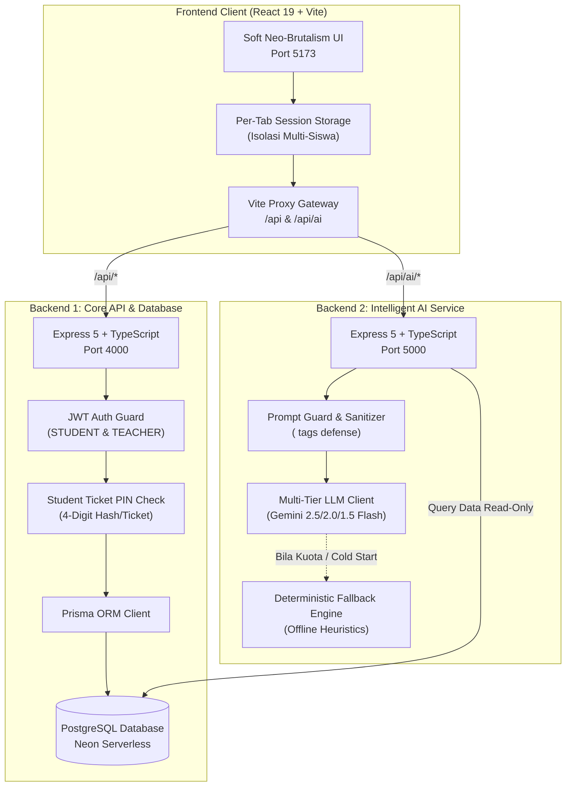
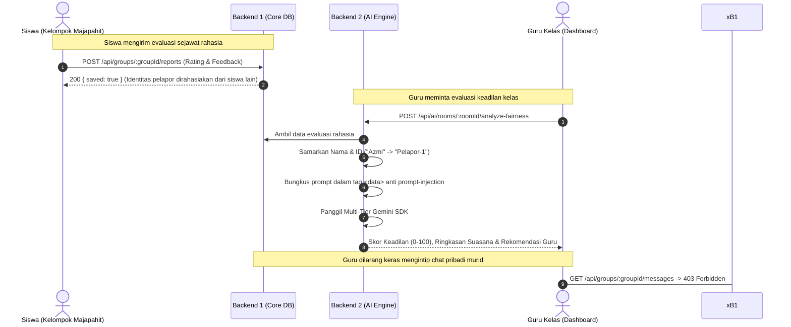

# Kelompok Adil 

> **Platform Kolaborasi Cerdas & Transparansi Kerja Kelompok Berbasis Multi-Tier AI Fasilitator**  
> *Kompetisi LOGICODIX Hackathon 2026 — Subtema: Smart & Fun Education (Kategori: Web Application)*

[](https://instagram.com/logicodix)
[](#-rekayasa-perangkat-lunak--arsitektur-software-engineering--bobot-25)
[](#-kesesuaian-masalah--solusi-problem-solution-fit--bobot-25)
[](#-pengujian-otomatis-automated-testing)

---

##  Informasi Tim & Karya

- **Judul Karya**: Kelompok Adil
- **Kategori**: Web Application (Subtema: *Smart & Fun Education*)
- **Nama Tim**: Kelompok Adil (Nama Registrasi: `BroTim`)
- **Asal Sekolah / Institusi**: SMKN 2 Kota Bekasi
- **Jurusan**: Rekayasa Perangkat Lunak (RPL)
- **Susunan Anggota Tim (Maksimal 4 Orang sesuai Ketentuan Lomba)**:
  1. **Ahmad Al Haykal** (NISN: `0102963233`) — Ketua Tim / Leader & Fullstack Orchestrator `[ROLE: ...]`
  2. **Azmi Fawwaz Nabiha** (NISN: `0091457995`) — `[ROLE: ...]`
  3. **Naufa Meylani Azizah** (NISN: `0102857398`) — `[ROLE: ...]`
  4. **Dafano Rizki Ramadhan** (NISN: `0098969418`) — `[ROLE: ...]`
- **Tautan Video Demonstrasi Fungsional (Durasi 3–5 Menit)**:  
  👉 **`[LINK VIDEO DEMO YOUTUBE / GOOGLE DRIVE]`**

---

## 💡 Kesesuaian Masalah & Solusi (Problem-Solution Fit — Bobot 25%)

### 1. Masalah yang Diangkat di Dunia Pendidikan
Metode pembelajaran berbasis proyek kelompok (*Project-Based Learning*) merupakan pilar utama Kurikulum Merdeka di sekolah. Namun, di lapangan kerap muncul friksi yang merusak semangat belajar siswa:

1. **Fenomena *Free Rider* & Siswa Pasif**:
   Ada siswa yang pasif atau sengaja tidak berkontribusi (*ghosting*), namun namanya tetap dicantumkan pada laporan akhir sehingga mendapat nilai yang sama dengan rekan yang berjuang keras.
2. **Subjektivitas & Beban Tidak Seimbang**:
   Pembagian tugas sering kali bias, tanpa acuan estimasi bobot kerja yang jelas (misalnya siswa A mengerjakan 80% materi, sedangkan siswa B hanya mencetak tugas).
3. **Keterbatasan Guru & Dilema Privasi**:
   Guru kesulitan memantau dinamika proses gotong royong di setiap kelompok secara objektif. Mengintip isi obrolan pribadi siswa melanggar ranah privasi pertemanan, sedangkan hanya menilai laporan akhir di hari pengumpulan mengabaikan proses keadilan kerja.

### 2. Deskripsi Solusi: Kelompok Adil
**Kelompok Adil** adalah aplikasi web kolaboratif yang menjembatani transparansi gotong royong siswa dan pemantauan objektif guru tanpa merusak privasi:
- **Target Pengguna**: Siswa dan Guru jenjang SMP, SMA, dan SMK.
- **Masuk Kelas Tanpa Registrasi Rumit**: Akses cepat dengan PIN Kelas 6-digit dan PIN Keamanan Pribadi 4-digit (mencegah pembajakan nama).
- **Pembagian Peran Terukur Tepat 100%**: AI Fasilitator menghitung usulan beban peran agar total persentase tepat 100% dengan format bukti luaran yang jelas.
- **Papan Kanban Akuntabel**: Setiap tugas memiliki penanggung jawab (PIC) dan bobot. Siswa hanya dapat memperbarui progres tugas miliknya sendiri.
- **Obrolan Tim Bebas Intervensi**: Ruang koordinasi murni antarsiswa yang terlindung dari akses guru.
- **Wadah Khusus AI Fasilitator**: Ruang terpisah untuk *brainstorming* ide materi dan panduan gotong royong.
- **Evaluasi Rahasia Sejawat (*Peer Review*)**: Siswa dapat memberikan penilaian rating bintang dan catatan refleksi jujur dengan identitas pelapor yang dirahasiakan dari siswa lain.
- **Dashboard Telemetri Guru**: Guru memantau skor keadilan kelas (*Fairness Score* 0–100) dan peringatan dini keterlambatan tugas (*Ghosting Alert*) tanpa membaca pesan obrolan siswa.

---

##  Daftar Fitur Utama yang Berfungsi di Branch `main`

Seluruh fitur di bawah telah teruji operasional secara *end-to-end* pada branch `main`:

| Fitur Utama | Hak Akses | Deskripsi & Bukti Fungsionalitas |
|---|---|---|
| **Akses Ruang Kelas Instan (PIN-based)** | Siswa & Guru | Masuk tanpa akun email/password. Siswa memasukkan Nama + PIN Kelas 6-digit + PIN Pribadi 4-digit. Guru masuk dengan Kode Unik Guru yang dapat digunakan berulang. |
| **Bagi Kelompok Otomatis (*Auto-Split*)** | Guru | Pembagian kelompok merata langsung dari lobi kelas berdasarkan target jumlah kelompok. |
| **Papan Tugas Kanban Akuntabel** | Siswa | Pembaruan status tugas (*Todo*, *In Progress*, *Done*) dan progres persentase. Dilengkapi validasi keamanan (hanya penanggung jawab tugas yang berhak mengubah progres). |
| **AI Fasilitator & Curah Ide** | Siswa | Diskusi interaktif dengan Google Gemini untuk perumusan ide topik proyek dan panduan belajar kelompok. |
| **Usulan Peran Adil (*Role Splitting*)** | Siswa | AI mengusulkan pembagian peran spesifik dengan total bobot tepat 100% dan format luaran tugas. Dapat langsung diterapkan ke Kanban (*1-click apply*) atau ditolak. |
| **Obrolan Rekan Kelompok (Neo-Brutalist)** | Siswa | Koordinasi terisolasi per kelompok dengan pembedaan sudut pandang (pesan sendiri di kanan berlabel *Kamu*, pesan rekan di kiri berlabel nama pengirim). Guru ditolak HTTP 403. |
| **Evaluasi Rahasia Sejawat (*Peer Review*)** | Siswa | Siswa mengirimkan rating (1–5 bintang) dan catatan refleksi performa rekan satu kelompok. Identitas pelapor dirahasiakan dari siswa lain. |
| **Dashboard Pemantauan Guru** | Guru | Pantau progres seluruh kelompok secara agregat, distribusi tugas per anggota, dan status penyelesaian tugas. |
| **Peringatan Dini Keterlambatan (*Ghosting Alert*)** | Guru | Peringatan otomatis jika ada tugas yang melewati tenggat waktu (*deadline*) dengan bahasa fasilitatif yang netral. |
| **Audit Laporan Rahasia Guru** | Guru | Rekap menyeluruh evaluasi sejawat untuk mediasi masalah nyata dan objektivitas penilaian guru. |
| **Analisis Keadilan AI (*Fairness Score*)** | Guru | Analisis AI terhadap suasana kerja kelas dengan skor keadilan (0–100) dan rekomendasi fasilitasi guru berbasis data evaluasi yang identitas pelapornya telah disamarkan. |

---

##  Dokumentasi Penggunaan AI (Sesuai Ketentuan Guidebook Hal. 18)

Sesuai ketentuan resmi kompetisi LOGICODIX 2026, penggunaan kecerdasan buatan diungkapkan secara transparan:

### A. Implementasi AI dalam Produk (Google Gemini API)

1. **Layanan & Model yang Digunakan**:
   - SDK Resmi: `@google/genai` (v2.32.0).
   - Arsitektur Model: **Multi-Tier Fallback Resilience**:
     - *Tier 1 (Utama)*: `gemini-2.5-flash` (Respon cepat, penalaran akurat).
     - *Tier 2 (Cadangan 1)*: `gemini-2.0-flash`.
     - *Tier 3 (Cadangan 2)*: `gemini-1.5-flash`.
     - *Tier 4 (Fallback Offline)*: Deterministic Fallback Engine (algoritma matematika & heuristik lokal).

2. **Bagian Produk yang Menggunakan AI**:
   - **AI Fasilitator**: Tanya jawab kelompok dan panduan curah ide.
   - **Usulan Bagi Peran Adil**: Kalkulasi pembagian peran dengan bobot tepat 100%.
   - **Rekomendasi PIC**: Menyarankan siswa dengan beban kerja paling ringan untuk tugas baru.
   - **Validasi Bukti Tugas**: Menilai kesesuaian deskripsi luaran tugas.
   - **Analisis Keadilan Kelas (*Fairness Score*)**: Memberikan skor keadilan 0–100 dan saran mediasi guru.

3. **Tata Kelola & Privasi Data AI (*Data Governance*)**:
   - **Yang dikirim ke Google Gemini**: Judul tugas, deskripsi, bobot beban kerja, dan teks catatan evaluasi yang telah disamarkan.
   - **Yang TIDAK PERNAH dikirim ke Google Gemini**:
     - Isi pesan obrolan internal antarsiswa.
     - Alamat email, password, atau credential pengguna.
     - Nama asli pelapor evaluasi sejawat (disamarkan menjadi token anonim seperti `Pelapor-1` sebelum dikirim ke API).
   - **Pertahanan *Prompt Injection***: Seluruh masukan teks bebas dibungkus di dalam blok `<data>...</data>` serta disanitasi dari tag manipulatif (`stripDataTags`).
   - **Transparansi Label Fallback**: Bila koneksi AI mengalami kendala (*timeout* atau batas kuota habis), sistem otomatis beralih ke mesin deterministik dengan menyematkan label transparan:  
     `"hasil otomatis, AI sedang tidak tersedia"`.

### B. Penggunaan AI Coding Assistant Selama Pengembangan

1. **Alat Bantu AI yang Digunakan Tim**:
   - **Google Antigravity Agent**
   - **Anthropic Claude**

2. **Peran Asisten AI dalam Pengembangan**:
   - Membantu perancangan arsitektur awal dan skema basis data relasional Prisma ORM.
   - Membantu pembuatan kerangka *boilerplate* endpoint Express dan pengujian otomatis (*automated test suite*).
   - Membantu refactoring antarmuka komponen UI Soft Neo-Brutalism.

3. **Tanggung Jawab Tim Pengembang**:
   - Seluruh kode hasil bantuan AI telah ditinjau (*peer review*), diuji dengan *automated test suite* (unit test & integrasi), dan divalidasi *end-to-end* oleh tim pengembang.
   - Tim bertanggung jawab penuh atas kualitas kode, keamanan, dan fungsionalitas aplikasi sesuai **Surat Pernyataan Orisinalitas Karya LOGICODIX 2026** yang ditandatangani Ketua Tim di atas meterai.

---

## 🏛️ Rekayasa Perangkat Lunak & Arsitektur (Software Engineering — Bobot 25%)

### 1. Diagram Arsitektur Multi-Service
Sistem dibangun dengan pemisahan tugas (*Separation of Concerns*) antar-layanan independen:



### 2. Diagram Alur Privasi Data (*Data Privacy by Design*)



### 3. Tumpukan Teknologi Teruji (*Tech Stack*)

- **Frontend Client**:
  - React 19 (React Compiler Ready, Hooks, Concurrent Rendering)
  - TypeScript & Vite 8
  - Tailwind CSS v4 dengan Design Tokens Kustom
  - Per-Tab Session Storage (Dukungan pengujian multi-akun siswa dalam satu peramban)
- **Backend 1 (Core Service — Port 4000)**:
  - Node.js & Express 5
  - TypeScript & Zod Data Validation
  - Prisma ORM 7 dengan Adapter PostgreSQL
  - JSON Web Token (JWT) + Student 4-Digit Ticket PIN Security
- **Backend 2 (AI Engine Service — Port 5000)**:
  - Node.js & Express 5
  - Google Gen AI SDK (`@google/genai`)
  - Multi-Tier Model Fallback (`gemini-2.5-flash` → `gemini-2.0-flash` → `gemini-1.5-flash` → Fallback Deterministik)
  - Sanitizer & Prompt Injection Armor
- **Database**:
  - PostgreSQL (Neon Serverless Cloud Database)

---

##  Desain & Pengalaman Pengguna (UI/UX — Bobot 15%)

Platform menerapkan bahasa desain **Soft Neo-Brutalism for Smart & Fun Education**:

1. **Karakter Visual yang Khas & Menyenangkan**:
   - Kontur tegas dengan border tebal 2px (`border-2 border-[#0f1b34]`).
   - Bayangan solid 3D terukur (`shadow-[3px_3px_0px_#0f1b34]`).
   - Tipografi terkurasi: **Bricolage Grotesque** (Judul, badge, dan elemen stiker) dan **Plus Jakarta Sans** (Isi teks dan navigasi).
   - Palet warna ceria edukatif: Warm Coral (`#f26b3a`), Golden Yellow (`#fec744`), Teal (`#30a49b`), dan Deep Ink (`#0f1b34`).

2. **Pengalaman Pengguna Tanpa Friksi (*Frictionless UX*)**:
   - **Tanpa Akun Rumit**: Guru dan siswa dapat bergabung dalam hitungan detik menggunakan kode PIN kelas.
   - **PIN Pribadi Siswa 4-Digit**: Melindungi akun siswa dari klaim iseng teman sekelas tanpa perlu menghafal email atau password panjang.
   - **Identitas Eksplisit**: Badge penanda `Kamu: {namaSiswa}` selalu terlihat di bilah navigasi dan tajuk obrolan.

3. **Desain Obrolan Tim Neo-Brutalist (Bukan Kloning Perpesanan Biasa)**:
   - Sisi **Kanan (Pesan Sendiri)**: Kartu neo-brutalist oranye cerah berbayangan solid 3D dengan label *"Kamu"*.
   - Sisi **Kiri (Pesan Rekan)**: Dilengkapi avatar inisial warna pastel dan label nama pengirim tebal berwarna.
   - Mengikuti kaidah sudut pandang intuitif yang selaras dengan seluruh antarmuka aplikasi.

---

##  Prinsip Khusus: Green IT, Etika & Privasi Data (Bobot 10%)

1. **Perlindungan Ruang Aman Siswa (*Data Privacy by Design*)**:
   - **Isolasi Obrolan**: Guru diblokir permanen (HTTP 403 Forbidden) saat mencoba mengakses obrolan tim siswa. Siswa berhak memiliki ruang diskusi yang leluasa tanpa rasa diawasi secara berlebihan.
   - **Kerahasiaan Evaluasi Sejawat**: Identitas pelapor pada fitur *Peer Review* dirahasiakan dari siswa lain untuk mencegah *peer pressure* atau perundungan.

2. **Etika Kecerdasan Buatan (*AI Ethics*)**:
   - **Penyamaran Data (*De-anonymization*)**: Sebelum dikirim ke Google Gemini, seluruh identitas pelapor disamarkan menjadi token anonim (misalnya `Pelapor-1`). Model AI tidak pernah menerima nama asli siswa pelapor.
   - **Pertahanan *Prompt Injection***: Seluruh teks masukan pengguna dibungkus di dalam tag isolasi `<data>...</data>` serta disanitasi dari tag manipulatif (`stripDataTags`) agar tidak dapat mengubah instruksi sistem.
   - **Transparansi Hasil *Fallback***: Jika terjadi kendala koneksi atau batas kuota API, sistem menyematkan label transparan:  
     `"hasil otomatis, AI sedang tidak tersedia"`.

3. **Efisiensi Sumber Daya (*Green IT*)**:
   - **Validasi Deterministik Lokal**: Perhitungan persentase kontribusi dan bobot tugas dikerjakan secara deterministik oleh server lokal sebelum memanggil LLM, menghemat konsumsi token API dan daya komputasi secara signifikan.
   - **Timeout Cepat & Caching**: Batas waktu eksekusi AI diatur ketat untuk mencegah *idle resource* yang memboroskan energi server.

---

##  Akun & Kredensial Pengujian Demo

Data uji coba telah disiapkan secara otomatis di basis data:

### 1. Akun Guru (*Teacher Role*)
- **PIN Kelas**: `810824` (atau `123456`)
- **Kode Unik Guru**: `GURU-DEMO-2026` *(Dapat digunakan berulang kali)*

### 2. Akun Siswa Terdaftar (*Student Role*)
- **PIN Kelas**: `810824`
- **PIN Pribadi Siswa**: `1234`
- **Pilihan Siswa untuk Menguji Sudut Pandang Berbeda**:
  - `haykal tampan`
  - `azmi`
  - `dafano`
*(Atau masukkan nama siswa baru + PIN 4-digit pilihan sendiri untuk mendaftar akun baru).*

---

##  Panduan Instalasi & Menjalankan Lokal (*Reproducible Setup*)

### Prasyarat
- Node.js versi 20+ atau 24+
- NPM versi 10+
- Koneksi Internet (untuk dependensi dan basis data Neon PostgreSQL)

### 1. Kloning Repositori & Instalasi Dependensi
```bash
git clone https://github.com/HAYKALAB/kelompok-adil.git
cd kelompok-adil
npm install
```

### 2. Konfigurasi Variabel Lingkungan (.env)

Salin berkas konfigurasi template di masing-masing direktori:

**Backend 1 (`backend/.env`):**
```env
PORT=4000
DATABASE_URL="postgres://[user]:[password]@[host]/[dbname]?sslmode=require"
CORS_ORIGIN="http://localhost:5173"
JWT_SECRET="kunci-rahasia-jwt-minimal-16-karakter"
```

**Backend 2 (`backend-2/.env`):**
```env
PORT=5000
AUTH_MODE=jwt
REPO_MODE=db
JWT_SECRET="kunci-rahasia-jwt-minimal-16-karakter"
BACKEND2_DATABASE_URL="postgres://[user]:[password]@[host]/[dbname]?sslmode=require"
GEMINI_API_KEY="<api-key-google-gemini>"
AI_MODEL=gemini-2.5-flash
AI_MOCK=false
```

**Frontend (`frontend/.env`):**
*(Biarkan kosong saat pengujian lokal agar menggunakan proxy Vite otomatis).*

### 3. Migrasi & Seed Basis Data
```bash
cd backend
npm run prisma:migrate
npm run prisma:seed
cd ..
```

### 4. Menjalankan Seluruh Layanan Sekaligus
Dari direktori utama (*root*):
```bash
npm run dev
```

Aplikasi dapat langsung diakses di peramban:
- **Frontend App**: [http://localhost:5173](http://localhost:5173)
- **Backend 1 Core API**: [http://localhost:4000](http://localhost:4000)
- **Backend 2 AI Engine**: [http://localhost:5000](http://localhost:5000)

---

##  Pengujian Otomatis (Automated Testing)

Platform dilengkapi pengujian otomatis komprehensif:

```bash
# 1. Jalankan test suite Backend 2 (40 Pengujian AI, Keamanan & Privasi)
npm --prefix backend-2 test

# 2. Jalankan test suite Backend 1 (Kontrak Database, PIN Keamanan & Laporan)
npx tsx backend/src/tests/auth-student-pin.test.ts
npx tsx backend/src/tests/room-detail.test.ts

# 3. Validasi kompilasi build produksi (Zero-Error Verification)
npm --prefix backend run build
npm --prefix backend-2 run build
npm --prefix frontend run build
```

---

##  Keterbatasan Jujur Sistem (Transparent Disclosures)

Sesuai etika kompetisi dan integritas akademik:
1. **Penyimpanan Obrolan**: Obrolan tim disimpan pada basis data server semata-mata untuk kontinuitas tugas proyek antaranggota kelompok. Guru dibatasi secara tegas (HTTP 403) dari mengakses pesan percakapan ini.
2. **Ketergantungan Kuota Eksternal AI**: Jika seluruh kuota pemanggilan Gemini API habis pada jam sibuk, sistem secara transparan mengaktifkan *Deterministic Fallback Engine* untuk menjamin fungsionalitas utama aplikasi tetap dapat berjalan tanpa kendala.
3. **Mediasi Guru**: Kerahasiaan evaluasi sejawat dirancang untuk melindungi siswa dari intimidasi rekan sejawat. Guru tetap dapat melihat identitas pelapor pada dashboard audit guru untuk tujuan intervensi dan konseling nyata di sekolah.
4. **Pembaruan Obrolan Berbasis Polling**: Pembaruan pesan pada tab obrolan menggunakan interval polling otomatis setiap 3 detik, bukan koneksi websocket persisten dua arah.

---

##  Lisensi & Atribusi Pihak Ketiga

Karya ini dikembangkan secara orisinal oleh Tim **Kelompok Adil** dari **SMKN 2 Kota Bekasi** untuk **LOGICODIX Hackathon Competition 2026**.

Atribusi pustaka dan aset pihak ketiga yang digunakan:
- **Google Gen AI SDK** (`@google/genai`) — Lisensi Apache 2.0
- **React & React DOM** (`react`) — Lisensi MIT
- **Tailwind CSS** (`tailwindcss`) — Lisensi MIT
- **Prisma ORM** (`@prisma/client`) — Lisensi Apache 2.0
- **Express.js** (`express`) — Lisensi MIT
- **Neon Serverless PostgreSQL** — Cloud Database Provider
- **Material Symbols & Google Fonts** (Bricolage Grotesque, Plus Jakarta Sans) — SIL Open Font License
