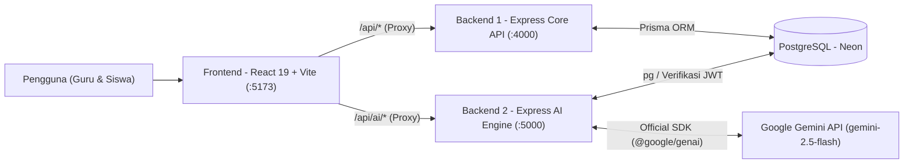

# Kelompok Adil

> **Platform Kolaborasi Tugas Kelompok Adil & Bebas Beban Berbasis AI**
>
> Karya Tim **BroTim** (SMKN 2 Kota Bekasi) untuk **LOGICODIX 2026 — Hackathon Competition**

---

## 1. Profil Aplikasi & Identitas Tim

| Informasi | Detail |
| :--- | :--- |
| **Nama Aplikasi** | Kelompok Adil |
| **Kategori** | Web Application |
| **Subtema** | Smart & Fun Education |
| **Target Pengguna** | Guru / Pengajar dan Pelajar (SMA/SMK/Sederajat & Mahasiswa) |
| **URL Aplikasi Live** | `[Isi tautan deployment sebelum submission]` |
| **Video Demo** | `[Isi tautan YouTube Unlisted/Public 3–5 menit sebelum submission]` |

### Tim BroTim — SMKN 2 Kota Bekasi

| No | Nama Lengkap | Peran |
| :-: | :--- | :--- |
| 1 | **Ahmad Al Haykal** | Ketua Tim & Backend 2 (AI Integration Engine) |
| 2 | **Azmi Fawwaz Nabiha** | Backend 1 (Database, Auth & Core API) |
| 3 | **Naufa Meylani Azizah** | Frontend / UI/UX *(sesuaikan detail peran tim)* |
| 4 | **Dafano Rizki Ramadhan** | Frontend / UI/UX *(sesuaikan detail peran tim)* |

---

## 2. Masalah yang Diangkat & Solusi

### Permasalahan Nyata di Kelas
1. **Fenomena *Free-Rider* (Beban Kelompok):** Dalam tugas kelompok, sering kali hanya 1–2 siswa yang bekerja keras sementara anggota lain pasif atau sekadar menumpang nama.
2. **Hambatan Psikologis Siswa (*Social Fear*):** Siswa yang aktif sering takut atau sungkan melaporkan anggota pasif ke guru karena khawatir dicap *"cepuan"* atau dikucilkan teman sekelas.
3. **Keterbatasan Pemantauan Guru (*Teacher Blindspot*):** Seorang guru tidak dapat mendampingi diskusi banyak kelompok secara bersamaan di dalam kelas dan umumnya hanya menerima hasil akhir tanpa mengetahui proses kontribusi masing-masing siswa.

### Solusi: Kelompok Adil
**Kelompok Adil** adalah platform kolaborasi kelas bertema *Soft Neo-Brutalism* (binder pelajar modern) yang memadukan manajemen tugas transparan, pelaporan sejawat anonim, dan **AI Fasilitator** berbasis Google Gemini agar setiap siswa berkontribusi secara adil dan gotong royong.

---

## 3. Daftar Fitur Utama

- **Room Kelas Berbasis PIN:** Guru membuat ruang tugas dengan PIN 6 digit; siswa bergabung dengan PIN dan kode/nama peserta.
- **Pembagian Kelompok Otomatis & Berimbang:** Pengelompokan siswa dari lobi kelas secara cepat dan merata.
- **Papan Tugas & Bukti Kerja (Kanban):** Pengelolaan sub-tugas per kelompok beserta unggah bukti pengerjaan dan progres masing-masing anggota.
- **AI Fasilitator Bersama (`Google Gemini`):** Ruang obrolan kelompok yang didampingi AI untuk memancing diskusi, mengusulkan pembagian peran adil (total bobot 100%), merekomendasikan penanggung jawab tugas, dan memvalidasi kelengkapan bukti kerja.
- **Laporan Sejawat Anonim (*Secret Peer Report*):** Mekanisme pelaporan rahasia yang melindungi identitas pelapor dari teman sekelompok dan hanya dapat diakses oleh guru.
- **Dashboard & Telemetri Guru:** Pantauan progres tiap kelompok, skala kontribusi deterministik, peringatan otomatis deteksi pasif/tenggat (*ghosting alert*), dan ringkasan catatan AI untuk guru.

---

## 4. Arsitektur Sistem & Alur Data

Proyek ini menggunakan struktur monorepo (*npm workspaces*) dengan pemisahan layanan yang jelas:



- **`frontend/` (Port `5173`):** Antarmuka pengguna (SPA) dengan Vite dev proxy (`/api` $\to$ `localhost:4000`, `/api/ai` $\to$ `localhost:5000`).
- **`backend/` (Port `4000`):** Core REST API untuk autentikasi JWT, manajemen room/PIN, grup, tugas, laporan rahasia, serta migrasi & seed database Neon PostgreSQL.
- **`backend-2/` (Port `5000`):** Layanan khusus kecerdasan buatan yang menangani prompt engineering, pembagian peran, chat fasilitator, analisis keadilan, dan deteksi *ghosting*.

---

## 5. Teknologi yang Digunakan

- **Frontend:** React 19, TypeScript, Vite 8, Tailwind CSS v4, React Router v7, TanStack Query v5.
- **Backend 1 (Core API):** Node.js, Express v5, TypeScript, Prisma ORM v7 (`@prisma/adapter-pg`), Zod, JSON Web Token (`jsonwebtoken`).
- **Backend 2 (AI Engine):** Node.js, Express v5, TypeScript, Google GenAI SDK (`@google/genai`), `pg`, Zod.
- **Database:** PostgreSQL (Neon Serverless Postgres).
- **Layanan AI & Tools:** Google Gemini API (`gemini-2.5-flash`), Prettier, Concurrently.

---

## 6. Panduan Instalasi & Konfigurasi Lokal

### Prasyarat
- Node.js v20+ & npm
- Database PostgreSQL (atau koneksi Neon PostgreSQL)
- Google Gemini API Key (dari Google AI Studio)

### Langkah Setup

1. **Clone repositori & instal seluruh dependensi workspace:**
   ```bash
   git clone https://github.com/HAYKALAB/kelompok-adil.git
   cd kelompok-adil
   npm install
   ```

2. **Konfigurasi Environment Variables (`backend/.env`):**
   Salin `backend/.env.example` menjadi `backend/.env`, lalu isi:
   - `PORT=4000`
   - `DATABASE_URL` — Connection string PostgreSQL / Neon
   - `CORS_ORIGIN="http://localhost:5173"`
   - `JWT_SECRET` — Secret key JWT (minimal 16 karakter)

3. **Konfigurasi Environment Variables (`backend-2/.env`):**
   Salin `backend-2/.env.example` menjadi `backend-2/.env`, lalu sesuaikan:
   - `PORT=5000`
   - `AUTH_MODE` — `jwt` (verifikasi token Backend 1) atau `stub` (dev lokal)
   - `JWT_SECRET` — Sama persis dengan `backend/.env` jika `AUTH_MODE=jwt`
   - `REPO_MODE` — `db` (Neon PostgreSQL) atau `stub` (in-memory mock)
   - `BACKEND2_DATABASE_URL` — Connection string PostgreSQL jika `REPO_MODE=db`
   - `GEMINI_API_KEY` — API Key Google Gemini (kosongkan jika `AI_MOCK=true`)
   - `AI_MODEL=gemini-2.5-flash`
   - `AI_MOCK` — `false` untuk respons AI nyata, `true` untuk mode simulasi

4. **Konfigurasi Frontend (`frontend/.env`):** *(Opsional untuk dev lokal)*
   Salin `frontend/.env.example` menjadi `frontend/.env` (`VITE_API_BASE_URL="/api"`).

5. **Migrasi & Seed Database (dari folder `backend/`):**
   ```bash
   cd backend
   npm run prisma:generate
   npm run prisma:migrate
   npm run prisma:seed
   cd ..
   ```

6. **Jalankan Seluruh Layanan Sekaligus (dari root):**
   ```bash
   npm run dev
   ```
   - Frontend: `http://localhost:5173`
   - Backend 1: `http://localhost:4000`
   - Backend 2 (AI): `http://localhost:5000`

---

## 7. Akun & Data Demonstrasi

Setelah menjalankan `npm run prisma:seed`, data kelas demo berikut siap digunakan untuk pengujian:

- **PIN Room Demo:** `123456` *(Proyek Sejarah Majapahit — XI IPS 2)*
- **Kode Login Guru:** `GURU-DEMO-2026` *(Ibu Ratna, M.Pd.)*
- **Kode Login Siswa:** `SISWA-MAJAPAHIT-01` s.d. `SISWA-MAJAPAHIT-08` *(lihat `backend/prisma/seed.ts`)*

---

## 8. Dokumentasi Penggunaan AI (Transparansi LOGICODIX 2026)

1. **AI di Dalam Produk (Fitur Aplikasi):**
   - Menggunakan **Google Gemini (`gemini-2.5-flash`)** melalui SDK resmi `@google/genai` pada layanan `backend-2/`.
   - Dimanfaatkan untuk: fasilitator diskusi kelompok, usulan pembagian peran adil (total beban 100%), rekomendasi penanggung jawab tugas, validasi kelengkapan bukti kerja, pengingat ramah (*nudge*), dan ringkasan dinamika kelompok bagi guru (dengan sanitasi nama pelapor pada laporan anonim).
2. **AI Coding & Design Assistant Selama Pengembangan:**
   - AI coding assistant (Claude via Hermes Agent & Antigravity/Gemini) dimanfaatkan untuk membantu perancangan fondasi arsitektur monorepo, skema Prisma, migrasi, seed, boilerplate endpoint, serta penyusunan panduan sistem desain awal.
   - Seluruh kode hasil bantuan AI ditinjau, disesuaikan, dan diverifikasi oleh tim (build, migrasi, seed, dan pengujian endpoint). Tim bertanggung jawab penuh atas keamanan, orisinalitas alur kerja, dan implementasi aplikasi.

---

## 9. Atribusi Sumber Daya Pihak Ketiga

- **Tipografi:** Google Fonts (`Bricolage Grotesque` & `Plus Jakarta Sans`).
- **Framework & Pustaka Open-Source:** React, Vite, Tailwind CSS, TanStack Query, React Router, Express, Prisma ORM, Zod, `jsonwebtoken`, `pg`, dan `@google/genai`.
- **Database Hosting:** Neon Serverless PostgreSQL.

---

## 10. Aturan Pengembangan Tim (Hacking Week)

- Menggunakan format Conventional Commits (`feat:`, `fix:`, `docs:`, `style:`, `refactor:`, `chore:`).
- Commit dilakukan secara berkala per fitur; tidak melakukan *bulk upload* maupun penulisan ulang riwayat Git (`force push`, `rebase`, `squash`) setelah push.
- Seluruh file `.env` dan kredensial rahasia dikecualikan lewat `.gitignore`.
