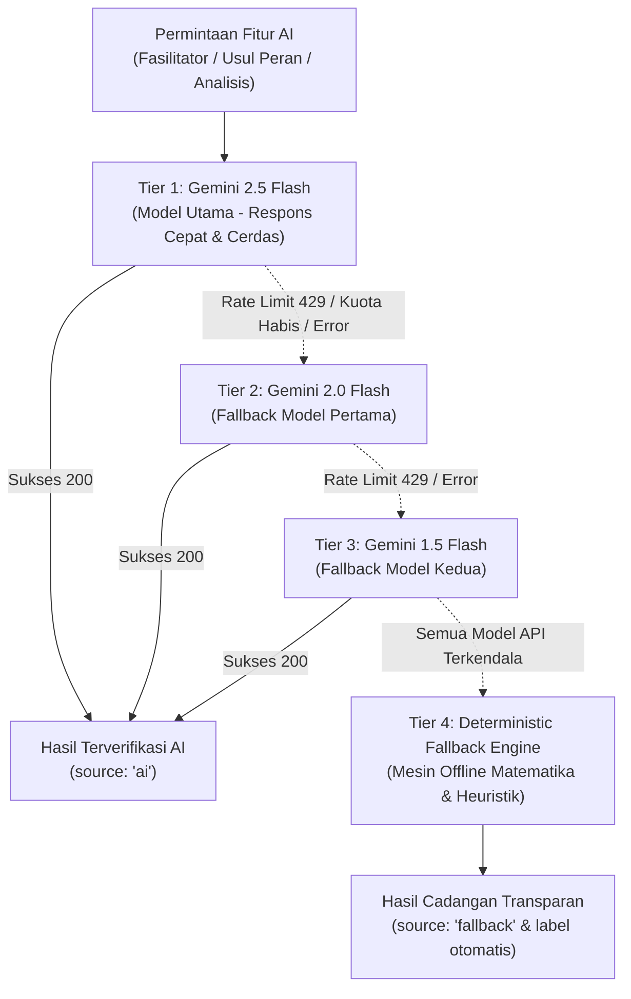
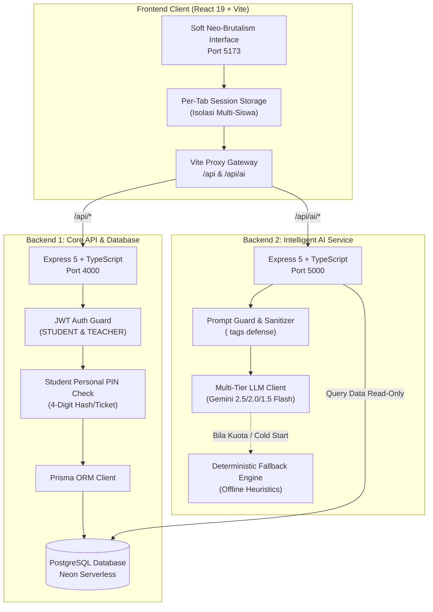
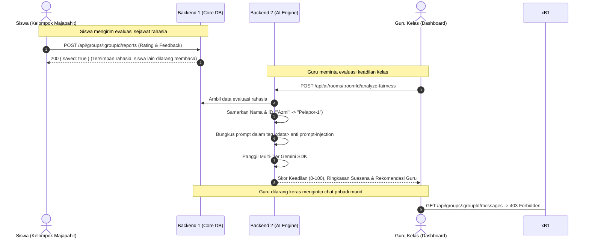

# Kelompok Adil ✦

> **Platform Kolaborasi Cerdas & Transparansi Kerja Kelompok Berbasis Multi-Tier AI Fasilitator**  
> *Kompetisi LOGICODIX Hackathon 2026 — Subtema: Smart & Fun Education (Kategori: Web Application)*

[](https://instagram.com/logicodix)
[](#-kesesuaian-masalah--solusi-problem-solution-fit--bobot-25)
[](https://ai.google.dev)
[](#-pengujian-otomatis-automated-testing)

---

## 👥 Informasi Tim & Karya

- **Judul Karya**: Kelompok Adil
- **Nama Tim**: Kelompok Adil (Nama Registrasi: `BroTim`)
- **Asal Sekolah / Institusi**: SMKN 2 Kota Bekasi
- **Jurusan**: Rekayasa Perangkat Lunak (RPL)
- **Susunan Anggota Tim**:
  1. **Ahmad Al Haykal** (NISN: `0102963233`) — Ketua Tim / Leader & Fullstack Orchestrator `[ROLE: ...]`
  2. **Azmi Fawwaz Nabiha** (NISN: `0091457995`) — `[ROLE: ...]`
  3. **Naufa Meylani Azizah** (NISN: `0102857398`) — `[ROLE: ...]`
  4. **Dafano Rizki Ramadhan** (NISN: `0098969418`) — `[ROLE: ...]`
- **Tautan Video Demo Fungsional (3–5 Menit)**:  
  👉 **`[LINK VIDEO DEMO YOUTUBE / GOOGLE DRIVE]`**

---

## 💡 Kesesuaian Masalah & Solusi (Problem-Solution Fit — Bobot 25%)

### 1. Konteks Masalah Pendidikan di Dunia Nyata
Metode pembelajaran berbasis proyek kelompok (*Project-Based Learning*) merupakan pilar utama Kurikulum Merdeka dan pendidikan modern. Namun, dalam praktiknya, kerja kelompok sering kali menjadi sumber kecemasan sosial dan ketidakadilan bagi siswa:

1. **Fenomena *Free Rider* & Siswa "Menghilang" (*Ghosting*)**:
   Ada siswa yang tidak berkontribusi sama sekali namun tetap menumpang nama pada laporan akhir, sehingga memperoleh nilai yang sama dengan rekan yang bekerja keras.
2. **Ketimpangan & Subjektivitas Pembagian Beban Tugas**:
   Pembagian tugas kerap didominasi oleh siswa vokal atau diserahkan secara sepihak tanpa estimasi bobot kerja yang adil (misalnya siswa A mengerjakan 80% beban laporan, siswa B hanya mencetak tugas).
3. **Keterbatasan Guru & Dilema Privasi Siswa**:
   Guru kesulitan memantau dinamika proses di setiap kelompok secara objektif. Mengintip ruang obrolan internal siswa melanggar ranah privasi pertemanan, sementara hanya menilai produk akhir di hari pengumpulan mengabaikan proses gotong royong dan kontribusi individu.

### 2. Solusi: Platform "Kelompok Adil"
**Kelompok Adil** dirancang untuk menghadirkan ekosistem kolaborasi kelas yang transparan, menyenangkan, dan berkeadilan:
- **Akses Instan & Aman**: Siswa masuk hanya dengan PIN Kelas 6-digit dan PIN Keamanan Pribadi 4-digit (mencegah pembajakan nama).
- **Pembagian Peran Presisi 100%**: AI Fasilitator mengkalkulasi distribusi tugas kelompok agar total beban bernilai tepat 100% dan mewajibkan format bukti nyata.
- **Papan Kanban Akuntabel**: Setiap tugas memiliki penanggung jawab (PIC) dan bobot. Siswa hanya dapat memperbarui progres tugas miliknya sendiri.
- **Obrolan Tim Terisolasi Tanpa Intervensi**: Ruang koordinasi murni antarsiswa yang dilindungi dari intipan guru demi kenyamanan diskusi.
- **AI Fasilitator Khusus Kelompok**: Wadah terpisah untuk *brainstorming* topik, merumuskan sudut pandang materi, dan mediasi gotong royong.
- **Evaluasi Rahasia Sejawat (*Peer Review*)**: Siswa dapat memberikan penilaian dan refleksi jujur secara anonim tanpa takut intimidasi rekan.
- **Dashboard Telemetri & Analisis Keadilan Guru**: Guru memantau skor keadilan kelas (*Fairness Score* 0–100) dan mendapatkan peringatan dini tugas tertunda (*Ghosting Alert*) tanpa melanggar privasi chat siswa.

---

## 🤖 Inovasi & Implementasi AI (Technology Innovation — Bobot 25%)

### A. Arsitektur Multi-Tier Model Fallback (Zero-Downtime AI)
Platform mengintegrasikan SDK resmi Google Gemini (`@google/genai` v2.32.0) dengan arsitektur ketahanan bertingkat (*multi-tier resilience*):



### B. Fitur-Fitur AI dalam Platform

| Fitur AI | Target Pengguna | Peran & Dampak Inovasi |
|---|---|---|
| **AI Group Facilitator** | Siswa | Memandu *brainstorming* topik proyek, merumuskan ide kreatif, dan membantu siswa yang bingung memulai tugas. |
| **Usulan Pembagian Peran Adil** | Siswa | Membagi peran proyek secara matematis tepat 100%, menetapkan PIC yang adil, serta mewajibkan luaran bukti kerja (*1-click apply to Kanban*). |
| **Rekomendasi Penanggung Jawab** | Siswa | Menghitung beban kerja saat ini dan merekomendasikan siswa dengan porsi paling ringan saat ada tugas baru (*Anti Free-Rider*). |
| **Validasi Bukti Tugas** | Siswa & Guru | Menganalisis relevansi bukti pengerjaan siswa terhadap deskripsi tugas yang dibebankan. |
| **Peringatan Dini *Ghosting* & Deadline** | Guru | Mendeteksi tugas yang melewati batas waktu dan mengirimkan pengingat ramah berbobot pedagogis kepada guru. |
| **Analisis Keadilan Kelas (*Fairness Score*)** | Guru | Menganalisis laporan sejawat secara anonim, menghitung indeks keadilan kelas (0–100), dan memberikan saran mediasi fasilitatif bagi guru. |

---

## 🏛️ Rekayasa Perangkat Lunak & Arsitektur (Software Engineering — Bobot 25%)

### 1. Diagram Arsitektur Multi-Service
Sistem dibangun dengan arsitektur multi-service yang memisahkan urusan basis data inti dan mesin kecerdasan buatan (*Separation of Concerns*):



### 2. Diagram Alur Privasi Data (*Data Privacy by Design*)



### 3. Tumpukan Teknologi Teruji (*Tech Stack*)

- **Frontend Client**:
  - React 19 (React Compiler Ready, Hooks, Concurrent Rendering)
  - TypeScript & Vite 8
  - Tailwind CSS v4 dengan Design Tokens Kustom
  - Per-Tab Session Storage (Dukungan pengujian multi-akun siswa dalam satu peramban)
- **Backend 1 (Core Service — Port 4000)**:
  - Node.js & Express 5
  - TypeScript & Zod Data Validation
  - Prisma ORM 7 dengan Adapter PostgreSQL
  - JSON Web Token (JWT) + Student 4-Digit Ticket PIN Security
- **Backend 2 (AI Engine Service — Port 5000)**:
  - Node.js & Express 5
  - Google Gen AI SDK (`@google/genai`)
  - Multi-Tier Model Fallback (`gemini-2.5-flash` → `gemini-2.0-flash` → `gemini-1.5-flash` → Fallback Deterministik)
  - Sanitizer & Prompt Injection Armor
- **Database**:
  - PostgreSQL (Neon Serverless Cloud Database)

---

## 🎨 Desain & Pengalaman Pengguna (UI/UX — Bobot 15%)

Platform menerapkan bahasa desain **Soft Neo-Brutalism for Smart & Fun Education**:

1. **Karakter Visual yang Khas & Menyenangkan**:
   - Kontur tegas dengan border tebal 2px (`border-2 border-[#0f1b34]`).
   - Bayangan solid 3D terukur (`shadow-[3px_3px_0px_#0f1b34]`).
   - Kombinasi tipografi modern: **Bricolage Grotesque** (Judul, badge, dan elemen stiker) dan **Plus Jakarta Sans** (Isi teks dan navigasi).
   - Palet warna ceria edukatif: Warm Coral (`#f26b3a`), Golden Yellow (`#fec744`), Teal (`#30a49b`), dan Deep Ink (`#0f1b34`).

2. **Pengalaman Pengguna Tanpa Friksi (*Frictionless UX*)**:
   - **Tanpa Registrasi Rumit**: Guru dan siswa dapat bergabung dalam hitungan detik menggunakan kode PIN kelas.
   - **PIN Pribadi Siswa 4-Digit**: Melindungi akun siswa dari klaim iseng teman sekelas tanpa perlu menghafal email atau password rumit.
   - **Identitas Eksplisit**: Badge penanda `Kamu: [Nama Siswa]` selalu terlihat di bilah navigasi dan tajuk obrolan.

3. **Desain Obrolan Tim Neo-Brutalist (Bukan Template Pasaran)**:
   - Sisi **Kanan (Pesan Sendiri)**: Kartu neo-brutalist oranye cerah berbayangan solid 3D dengan label *"Kamu"*.
   - Sisi **Kiri (Pesan Rekan)**: Dilengkapi avatar inisial warna pastel dan label nama pengirim tebal berwarna.
   - Mengikuti kaidah sudut pandang intuitif tanpa menggunakan template kloning perpesanan biasa.

---

## 🌱 Prinsip Khusus: Green IT, Etika & Privasi Data (Bobot 10%)

### 1. *Data Privacy by Design* (Perlindungan Ruang Aman Siswa)
- **Isolasi Obrolan**: Guru diblokir permanen (HTTP 403 Forbidden) saat mencoba mengakses obrolan tim siswa. Siswa berhak memiliki ruang diskusi yang leluasa tanpa rasa diawasi secara berlebihan.
- **Anonimitas Evaluasi Sejawat**: Identitas pelapor pada fitur *Peer Review* dirahasiakan sepenuhnya dari siswa lain untuk mencegah *peer pressure* atau perundungan.

### 2. Etika Kecerdasan Buatan (*AI Ethics*)
- **Penyamaran Data (*De-anonymization*)**: Sebelum dikirim ke Google Gemini, seluruh identitas pelapor disamarkan menjadi token anonim (misalnya `Pelapor-1`). Model AI tidak pernah menerima nama asli siswa pelapor.
- **Pertahanan *Prompt Injection***: Seluruh teks masukan pengguna dibungkus di dalam tag isolasi `<data>...</data>` serta disanitasi dari tag manipulatif (`stripDataTags`) agar tidak dapat mengubah instruksi sistem.
- **Transparansi Hasil *Fallback***: Jika terjadi kendala koneksi atau batas kuota API, sistem menyematkan label transparan:  
  `"hasil otomatis, AI sedang tidak tersedia"`.

### 3. Efisiensi Sumber Daya (*Green IT*)
- **Validasi Deterministik Lokal**: Perhitungan persentase kontribusi dan bobot tugas dikerjakan secara deterministik oleh server lokal sebelum memanggil LLM, menghemat konsumsi token API dan daya komputasi secara signifikan.
- **Timeout Cepat & Caching**: Batas waktu eksekusi AI diatur ketat untuk mencegah *idle resource* yang memboroskan energi server.

---

## 🔑 Akun & Kredensial Pengujian Demo

Data uji coba telah disiapkan secara otomatis di basis data:

### 1. Akun Guru (*Teacher Role*)
- **PIN Kelas**: `810824` (atau `123456`)
- **Kode Unik Guru**: `GURU-DEMO-2026` *(Dapat digunakan berulang kali)*

### 2. Akun Siswa Terdaftar (*Student Role*)
- **PIN Kelas**: `810824`
- **PIN Pribadi Siswa**: `1234`
- **Pilihan Siswa untuk Menguji Sudut Pandang Berbeda**:
  - `haykal tampan`
  - `azmi`
  - `dafano`
*(Atau masukkan nama siswa baru + PIN 4-digit pilihan sendiri untuk mendaftar akun baru).*

---

## 💻 Panduan Instalasi & Menjalankan Lokal (*Reproducible Setup*)

### Prasyarat
- Node.js versi 20+ atau 24+
- NPM versi 10+
- Koneksi Internet (untuk dependensi dan basis data Neon)

### 1. Kloning Repositori & Instalasi
```bash
git clone https://github.com/HAYKALAB/kelompok-adil.git
cd kelompok-adil
npm install
```

### 2. Konfigurasi Variabel Lingkungan (.env)

**Backend 1 (`backend/.env`):**
```env
PORT=4000
DATABASE_URL="postgres://[user]:[password]@[host]/[dbname]?sslmode=require"
CORS_ORIGIN="http://localhost:5173"
JWT_SECRET="kunci-rahasia-jwt-minimal-16-karakter"
```

**Backend 2 (`backend-2/.env`):**
```env
PORT=5000
AUTH_MODE=jwt
REPO_MODE=db
JWT_SECRET="kunci-rahasia-jwt-minimal-16-karakter"
BACKEND2_DATABASE_URL="postgres://[user]:[password]@[host]/[dbname]?sslmode=require"
GEMINI_API_KEY="<api-key-google-gemini>"
AI_MODEL=gemini-2.5-flash
AI_MOCK=false
```

### 3. Migrasi & Seed Basis Data
```bash
cd backend
npm run prisma:migrate
npm run prisma:seed
cd ..
```

### 4. Menjalankan Seluruh Layanan Sekaligus
Dari direktori utama (*root*):
```bash
npm run dev
```

Aplikasi dapat langsung diakses di peramban:
- **Frontend App**: [http://localhost:5173](http://localhost:5173)
- **Backend 1 Core API**: [http://localhost:4000](http://localhost:4000)
- **Backend 2 AI Engine**: [http://localhost:5000](http://localhost:5000)

---

## 🧪 Pengujian Otomatis (Automated Testing)

Platform dilengkapi pengujian otomatis komprehensif:

```bash
# 1. Jalankan test suite Backend 2 (40 Pengujian AI, Keamanan & Privasi)
npm --prefix backend-2 test

# 2. Jalankan test suite Backend 1 (Kontrak Database, PIN Keamanan & Laporan)
npx tsx backend/src/tests/auth-student-pin.test.ts
npx tsx backend/src/tests/room-detail.test.ts

# 3. Validasi kompilasi build produksi (Zero-Error Verification)
npm --prefix backend run build
npm --prefix backend-2 run build
npm --prefix frontend run build
```

---

## ⚖️ Keterbatasan Jujur Sistem (Transparent Disclosures)

Sesuai etika kompetisi dan integritas akademik:
1. **Penyimpanan Obrolan**: Obrolan tim disimpan pada basis data server semata-mata untuk kontinuitas tugas proyek antaranggota kelompok. Guru dibatasi secara tegas (403) dari mengakses pesan percakapan ini.
2. **Ketergantungan Kuota Eksternal AI**: Jika seluruh kuota pemanggilan Gemini API habis pada jam sibuk, sistem secara transparan mengaktifkan *Deterministic Fallback Engine* untuk menjamin fungsionalitas aplikasi tetap 100% berjalan tanpa *crash*.
3. **Mediasi Guru**: Anonimitas *peer review* dirancang untuk melindungi siswa dari intimidasi rekan sejawat. Guru tetap dapat melihat identitas pelapor pada dashboard audit guru untuk tujuan intervensi dan konseling nyata di sekolah.

---

## 📜 Lisensi & Integritas Orisinalitas

Karya ini dikembangkan secara orisinal oleh Tim **Kelompok Adil** dari **SMKN 2 Kota Bekasi** untuk **LOGICODIX Hackathon Competition 2026**.  
Seluruh pustaka pihak ketiga (*Google Gen AI SDK, React, Tailwind CSS, Prisma ORM, Express, Neon PostgreSQL*) digunakan sesuai lisensi sumber terbuka masing-masing.
